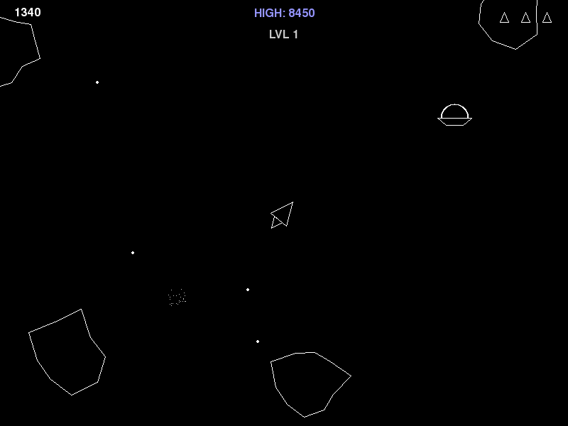

# Retro Asteroids

A vector-style space shooter in Python, inspired by the 1979 arcade classic *Asteroids*.
Everything is drawn with simple lines and the sound effects are generated in code, so the
game has no image or audio files at all.



## Features

- Ship with rotation, thrust, inertia and screen wrap-around
- Procedurally shaped asteroids that split into smaller pieces when shot
- Two kinds of UFOs: a large one that fires randomly and a small one that aims at you
- Particle explosions and synthesized retro sound effects
- Increasing difficulty per wave, extra life every 10,000 points
- Persistent high score, title and game-over screens, pause
- 51 unit and smoke tests covering physics, collisions, scoring and the game loop

## Getting started

Requires Python 3.10+.

```bash
git clone https://github.com/MinZziGOGOGO/retro-asteroids.git
cd retro-asteroids
python -m venv .venv && source .venv/bin/activate   # Windows: .venv\Scripts\activate
pip install -r requirements.txt

python -m retro_asteroids.main
```

## Controls

| Key | Action |
|-----|--------|
| ← / → | Rotate |
| ↑ | Thrust |
| Space | Fire |
| P | Pause |
| Enter | Start / restart |
| Esc | Quit |

## Scoring

| Target | Points |
|--------|--------|
| Large asteroid | 20 |
| Medium asteroid | 50 |
| Small asteroid | 100 |
| Large UFO | 200 |
| Small UFO | 1000 |

## Running the tests

```bash
pip install -r requirements-dev.txt
pytest
```

The tests run headless (no window or audio device needed) and use a temporary high score file.

## Project structure

```
retro_asteroids/
├── main.py        # Game loop and state machine (title → playing → game over)
├── ship.py        # Player ship: rotation, thrust, friction, respawn
├── asteroid.py    # Procedural asteroid shapes and splitting
├── bullet.py      # Projectiles with lifetime and wrap-around
├── ufo.py         # Enemy saucers and their shooting logic
├── collision.py   # Circle–circle and circle–polygon collision tests
├── particles.py   # Explosion particles
├── game_state.py  # Score, lives, levels, high score persistence
├── screens.py     # Title, HUD, pause and game-over screens
└── sound.py       # Square-wave and noise sound effects generated at runtime
```

## Tech stack

Python 3 · [pygame-ce](https://pyga.me) · pytest
